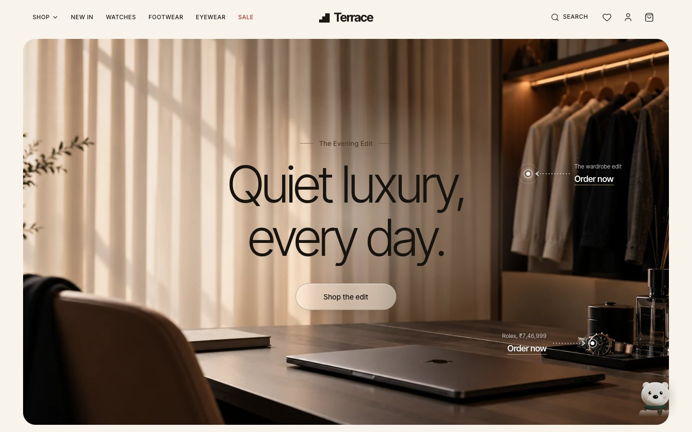
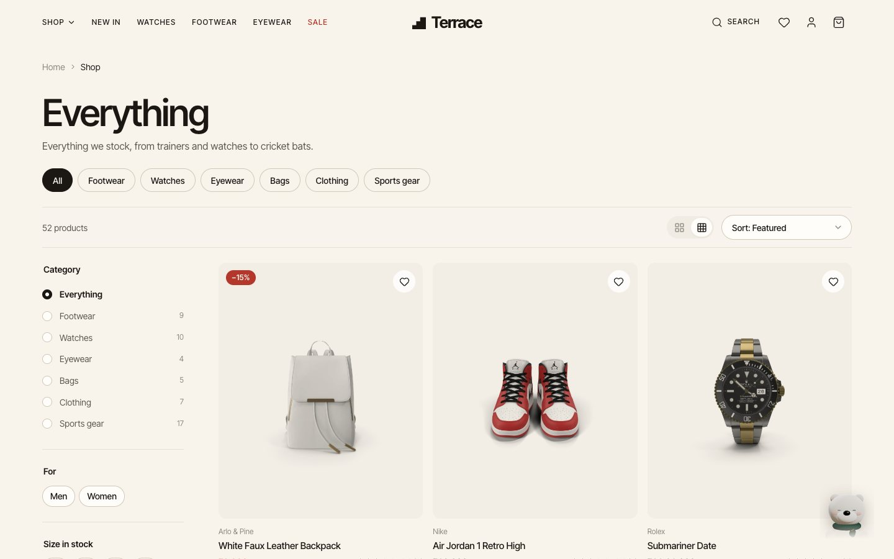
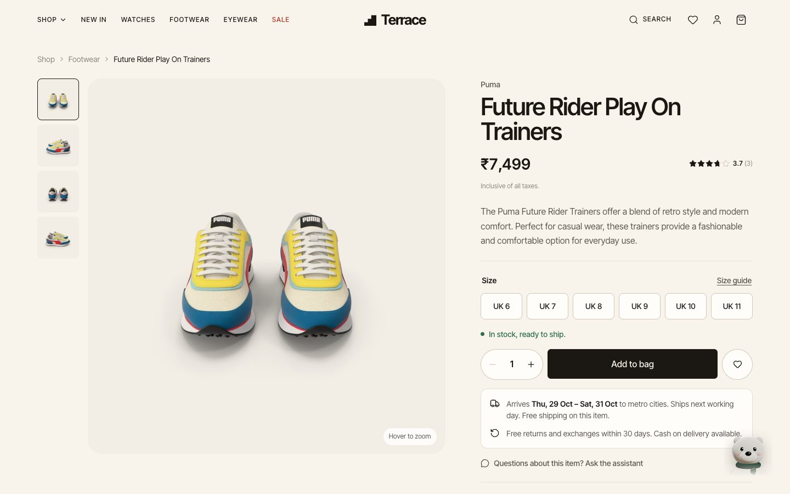
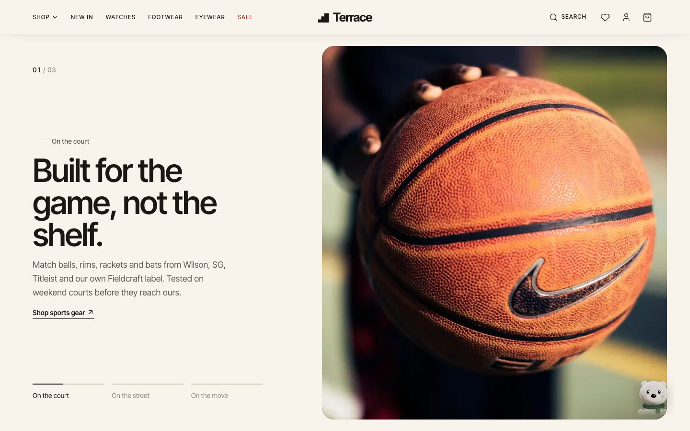
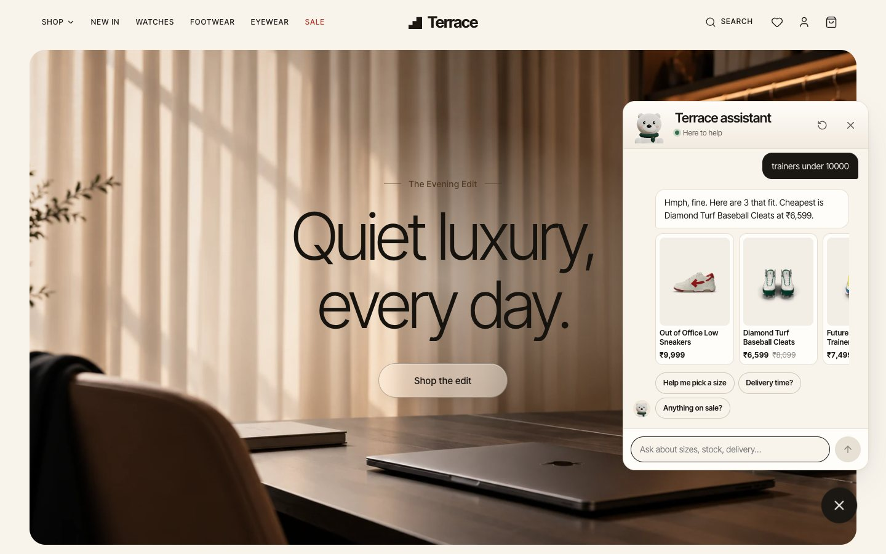
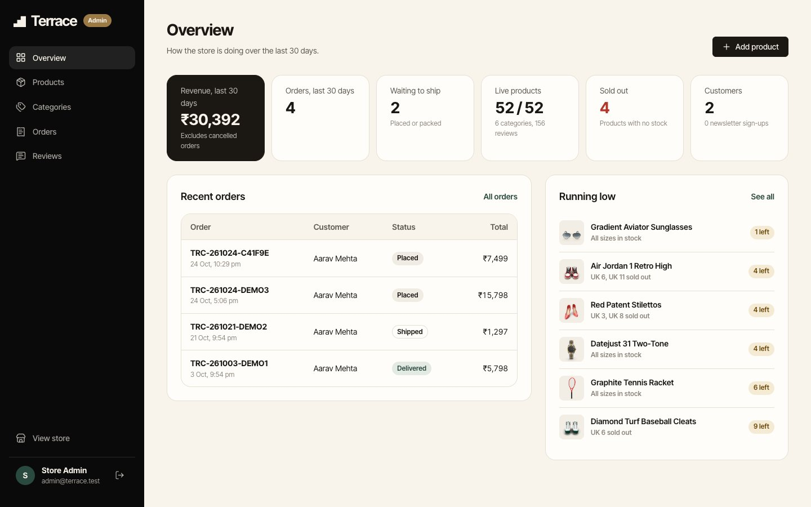
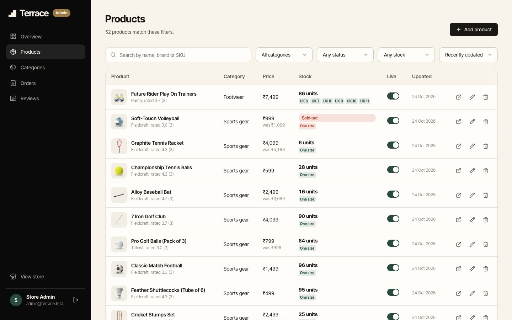

<p align="center">
  
</p>

<h1 align="center">Terrace</h1>

<p align="center">
  <strong>An independent sport and street store from Bengaluru.</strong><br />
  A full-stack e-commerce web application built for the Web Developer hiring assignment.
</p>

<p align="center">
  
  
  
  
  
</p>

<p align="center">
  <a href="#live-demo">Live demo</a> ·
  <a href="#features">Features</a> ·
  <a href="#run-it-locally">Run locally</a> ·
  <a href="#deployment">Deployment</a> ·
  <a href="docs/EVALUATION.md">Evaluation summary</a>
</p>

---

Terrace sells trainers, watches, eyewear, bags, clothing and sports gear, with real product photography. It has:

- a custom storefront;
- email and password accounts;
- a bag and checkout priced by the server;
- reviews and a wishlist;
- an admin dashboard with Cloudinary image uploads;
- a shopping assistant, a small 3D polar bear that knows the live catalogue.

Every product, price and stock level comes from the database. The browser is never trusted with a price.

## Live demo

| | |
|---|---|
| **Storefront** | _Vercel URL, added after deployment_ |
| **API** | _Render URL, added after deployment_ |
| **Repository** | https://github.com/samay-hash/terrace |
| **Demo accounts** | Admin and customer credentials are shared privately with reviewers, as the brief asks |

## Contents

- [Features](#features)
- [Screenshots](#screenshots)
- [Tech stack](#tech-stack)
- [Architecture](#architecture)
- [Run it locally](#run-it-locally)
- [Testing](#testing)
- [Deployment](#deployment)
- [Submission checklist](#submission-checklist)
- [Documentation](#documentation)
- [AI tools disclosure](#ai-tools-disclosure)
- [Credits](#credits)

## Features

### Storefront

- **Home page:** a sequence of editorial sections, top to bottom:
  - **Hero:** a photograph of a sunlit study, with dotted "Order now" pointers on the watch and the wardrobe.
  - **This week at Terrace:** a two-row grid with New in, Bestsellers, Top rated and On sale tabs.
  - **Category explorer:** hovering a department swaps the photo.
  - **Scroll story:** the section holds still while each chapter's photo wipes up over the last.
  - **Sale panel:** a live count of reduced pieces.
  - **Photo bands:** photos that cross-fade slowly with a sweep of warm light.
- **Header:** sticky, turning to frosted glass on scroll. It has a Shop mega menu (categories, brands, collections, editor's pick) and a search overlay with live results; press `/` anywhere to open it.
- **Shop:**
  - search by name, brand or SKU;
  - filter by category, men or women, size in stock, brand, price band, rating, sale and stock;
  - sort by featured, newest, bestselling, top rated and price;
  - numbered pagination, with every choice kept in the URL.
- **Product cards:** hover shows a second photo, with quick add, a wishlist heart, ratings, and sale and new badges.
- **Product page:**
  - gallery with hover zoom (swipe on phones);
  - sizes in the product's own run (UK shoe sizes, XS–XXL or One size), with sold-out sizes crossed out;
  - a size guide;
  - a live stock message;
  - a delivery estimate with a dispatch countdown;
  - reviews with a star breakdown;
  - related and recently viewed products.
- **Bag, checkout and orders:**
  - a slide-in bag and a full bag page;
  - a free-shipping meter;
  - cash-on-delivery checkout with address validation;
  - order history with a status timeline.
- **Accounts:**
  - sign up and sign in with inline validation;
  - a wishlist;
  - a help centre with size charts;
  - a working newsletter form.

### Admin dashboard (`/admin`, admin role only)

- **Overview:** 30-day revenue and orders, orders waiting to ship, live and sold-out products, customers, recent orders and a low-stock list.
- **Products:** search, filter (category, live or hidden, low or sold-out stock), sort, paginate, toggle live, and delete with confirmation.
- **Product editor:**
  - name, description, price and compare-at price, category, brand, gender and SKU;
  - highlights;
  - stock per size, with size presets;
  - drag-and-drop image upload to Cloudinary (reorder, set cover, alt text).
- **Categories, orders and reviews:**
  - categories: create, edit and reorder; a category cannot be deleted while products use it;
  - orders: move through placed → packed → shipped → delivered, or cancel (cancelling returns the stock);
  - reviews: moderate them; product ratings are recalculated.

### The Terrace assistant

- **The bear:** a 3D polar bear built with three.js and loaded only when shown. It follows the cursor, blinks, thinks while a reply loads and talks when it lands. Reduced-motion users see a still pose, and browsers without WebGL see a flat illustration.
- **What it answers:** questions about products, stock by size, sizing, delivery, returns and payment. For signed-in shoppers it also knows their bag and latest order, the page they are on and their wishlist. It recommends products as tappable cards.
- **How replies are made:** with `ANTHROPIC_API_KEY` set, replies come from Claude using the live catalogue as context. Without a key, a rule-based engine answers from the same live data, so the assistant always works.

## Screenshots

| | |
|---|---|
|  |  |
| **Shop:** search, filters, sorting and pagination | **Product page:** gallery, sizes, stock and delivery estimate |
|  |  |
| **Scroll story:** chapters with wipe transitions | **Assistant:** answers from the live catalogue |
|  |  |
| **Admin overview** | **Admin products:** search, filter, stock, live toggle |

## Tech stack

| Layer | Technology | Why |
|---|---|---|
| Frontend | React 19, Vite, React Router, React Query | Lazy-loaded pages, cached server state, and a separate admin bundle |
| Styling | Hand-written CSS Modules on shared design tokens | A custom look with no UI kit, and one typeface (Inter Tight) throughout |
| Backend | Node.js, Express 5 | Routes → controllers → services → models, with native async error handling |
| Database | MongoDB Atlas with Mongoose | Products carry stock per size, which fits documents well; there are indexes for the catalogue queries |
| Images | Cloudinary | Uploads are validated and re-encoded on the server; keys never reach the browser |
| Auth | JWT in an `httpOnly`, `SameSite` cookie; bcrypt | The token can't be read by page scripts, and sessions can be revoked |
| Validation | zod | Every request body, query and set of URL parameters is checked |
| 3D | three.js | The assistant, loaded on demand as its own chunk |
| Hosting | Vercel (storefront), Render (API) | Vercel forwards `/api` to Render, so the cookie stays first-party |

## Architecture

```
Browser ──► Vercel ── React storefront (static)
               │
               └─ /api/*  rewrite ──► Render ── Express API
                                         │
                                         ├──► MongoDB Atlas   users, catalogue, carts, orders, reviews
                                         └──► Cloudinary      product images
```

```
client/                      React app (Vite)
  src/components/            ui/ layout/ product/ cart/ home/ chat/ auth/ admin/
  src/context/               Auth, Cart (guest + server bag), Wishlist, Toast
  src/hooks/                 React Query data hooks and small utilities
  src/pages/                 Store pages and pages/admin/
  vercel.json                SPA fallback, /api rewrite to Render, security headers
server/                      Express API
  src/config/                Environment validation (zod), MongoDB connection
  src/models/                User, Category, Product, Review, Cart, Order, Subscriber
  src/middleware/            Auth, CSRF header, validation, sanitising, rate limits, uploads, errors
  src/controllers/           Route handlers per resource
  src/services/              Pricing, catalogue queries, reviews, image storage, assistant
  src/routes/index.js        Every route; admin routes grouped behind requireRole("admin")
  seed/                      Catalogue data, product photos and the seed script
  tests/                     node:test + supertest suites
docs/                        Evaluation, requirements, database, API, security, architecture
render.yaml                  Render blueprint for the API
```

## Run it locally

**Requirements:** Node.js 22.9 or newer, and MongoDB (a local `mongod` or an Atlas cluster). Cloudinary and an Anthropic key are optional for local work.

```bash
# 1. API
cd server
cp .env.example .env     # set JWT_SECRET and the SEED_* passwords
npm install
npm run seed             # 6 categories, 52 products with photos, reviews, demo accounts, sample orders
npm run dev              # http://localhost:4000

# 2. Storefront (in a second terminal)
cd client
npm install
npm run dev              # http://localhost:5173
```

Vite proxies `/api` and `/uploads` to the API, so the browser talks to one origin, as it does in production.

Without Cloudinary keys, uploads are stored on disk in `server/uploads/`. This fallback is for development only; in production the upload endpoint refuses to run without Cloudinary.

<details>
<summary><strong>Environment variables</strong> (<code>server/.env</code>)</summary>

| Variable | Required | Purpose |
|---|---|---|
| `MONGODB_URI` | yes | MongoDB connection string |
| `JWT_SECRET` | yes | 32+ random characters for signing sessions |
| `CLIENT_ORIGIN` | yes | Storefront origin(s) allowed by CORS, comma-separated |
| `TRUST_PROXY` | production | Number of proxies in front of the API (2 for Vercel → Render) |
| `COOKIE_SAMESITE` | no | `lax` (default) or `none` for a cross-site setup |
| `CLOUDINARY_CLOUD_NAME`, `CLOUDINARY_API_KEY`, `CLOUDINARY_API_SECRET` | production | Image hosting |
| `CLOUDINARY_FOLDER` | no | Upload folder, default `terrace/products` |
| `ANTHROPIC_API_KEY`, `CHAT_MODEL` | no | Enables the Claude-powered assistant |
| `SEED_ADMIN_EMAIL`, `SEED_ADMIN_PASSWORD` | seed | Demo admin created by `npm run seed` |
| `SEED_CUSTOMER_EMAIL`, `SEED_CUSTOMER_PASSWORD` | seed | Demo customer |

The configuration is validated at start-up; a missing or weak value stops the server with a readable message.

</details>

<details>
<summary><strong>Scripts</strong></summary>

| Where | Command | What it does |
|---|---|---|
| server | `npm run dev` | API with file watching |
| server | `npm run seed` | Adds anything missing; `npm run seed -- --reset` clears the catalogue, reviews, carts and orders first |
| server | `npm test` | Runs the test suite against a separate test database |
| server | `npm run fetch-catalog` | Re-downloads the catalogue and photos from DummyJSON |
| client | `npm run dev` / `npm run build` | Development server / production build |

</details>

## Testing

- **60 automated API tests** (`cd server && npm test`), all passing. They cover:
  - sign-up, sign-in, sessions and revocation;
  - CSRF and admin authorisation (guests get 401, customers get 403);
  - validation, and NoSQL and regex injection;
  - server-side cart pricing, order isolation and concurrent checkout of the last item;
  - uploads, reviews, headers and rate limits.
- **In a browser:**
  - every store page at 1440 and 390 px, and the home, shop and product pages at 1920, 1200 and 768 px;
  - the guest bag → sign in → merged bag → checkout → order flow;
  - the admin create → upload image → edit → delete flow, with images landing in Cloudinary.
- **Security measures:** each one is listed with the test that proves it in [docs/SECURITY.md](docs/SECURITY.md).

## Deployment

The storefront runs on **Vercel**, the API on **Render**, data on **MongoDB Atlas** and images on **Cloudinary**.

1. **MongoDB Atlas:**
   - Create a free M0 cluster and a database user.
   - Under Network Access, allow `0.0.0.0/0`, because Render's free plan has no fixed IP.
   - Copy the connection string, adding `/terrace` as the database name.
2. **Cloudinary:** copy the cloud name, API key and API secret from Settings → API Keys.
3. **Seed production once** from your machine, with the production values in `server/.env.production` (git-ignored):
   ```bash
   cd server && node --env-file=.env.production seed/seed.js
   ```
   This uploads every product photo to Cloudinary and creates the demo accounts.
4. **Render:**
   - Choose New → Blueprint and pick this repository; `render.yaml` describes the service.
   - Fill in `MONGODB_URI`, the three Cloudinary values and `CLIENT_ORIGIN` (the Vercel URL). `JWT_SECRET` is generated for you.
   - Check `https://<render-url>/api/health`; it returns `{"ok":true}`.
5. **Vercel:**
   - Import the repository and set the root directory to `client` (framework: Vite).
   - Point the `/api/:path*` rewrite in `client/vercel.json` at the Render URL, then deploy.
6. Sign in as the admin on the Vercel URL and check the dashboard.

## Submission checklist

Following section 11 of the brief:

| # | Item | Where |
|---|---|---|
| 1 | Live website URL | [Live demo](#live-demo) (added after deployment) |
| 2 | GitHub repository URL | https://github.com/samay-hash/terrace |
| 3 | Admin demo credentials | Shared privately with reviewers; not in this repository |
| 4 | Customer demo credentials | Shared privately; the account has three sample orders |
| 5 | README with local setup and deployment | This file: [Run it locally](#run-it-locally), [Deployment](#deployment) |
| 6 | Database schema documentation | [docs/DATABASE.md](docs/DATABASE.md) |
| 7 | Technologies and architectural decisions | [Tech stack](#tech-stack), [docs/ARCHITECTURE.md](docs/ARCHITECTURE.md) |
| 8 | AI tools disclosure | [AI tools disclosure](#ai-tools-disclosure) |
| 9 | Confirmation that the main features were tested | [Testing](#testing), [docs/ARCHITECTURE.md](docs/ARCHITECTURE.md#what-was-tested) |

No passwords, database credentials or API keys are committed; `.env` files are git-ignored, and `.env.example` holds empty placeholders only.

## Documentation

| Document | Contents |
|---|---|
| [EVALUATION.md](docs/EVALUATION.md) | The brief's evaluation criteria: what is complete for each and how to check it |
| [REQUIREMENTS.md](docs/REQUIREMENTS.md) | Every requirement in the brief and where it is implemented |
| [DATABASE.md](docs/DATABASE.md) | Collections, fields, indexes and relationships |
| [API.md](docs/API.md) | Every endpoint and who may call it |
| [SECURITY.md](docs/SECURITY.md) | Each security measure and the test that proves it |
| [ARCHITECTURE.md](docs/ARCHITECTURE.md) | Technology choices, key decisions, design notes and what was tested |

## AI tools disclosure

This project was built with Claude (Anthropic), using Claude Code as a coding assistant, under my direction and review. It was used for:

- scaffolding;
- components and API code;
- the catalogue import script;
- documentation and tests.

Every feature was reviewed and tested before it was kept. Claude also powers the store assistant at runtime when an `ANTHROPIC_API_KEY` is configured. More detail is in [docs/ARCHITECTURE.md](docs/ARCHITECTURE.md#ai-tools-disclosure).

## Credits

- **Products, photos and seed reviews:** [DummyJSON](https://dummyjson.com), an open-source mock-data API.
  - Placeholder brand names were mapped to house labels: Terrace Studio, Fieldcraft, Vera Nolan, Haldane & Co., Solstice Optics and Arlo & Pine.
  - Prices were converted to rupees.
- **Editorial photos:** Wikimedia Commons, all CC0 (Unsplash uploads). Each is credited on the Help page (`/help#credits`) and listed in `client/src/lib/photos.js`. The hero and sign-in photos were supplied by the project owner.
- **Font:** Inter Tight (SIL Open Font License), served by Google Fonts.

<p align="center"><sub>A demo store: nothing is shipped or charged.</sub></p>
